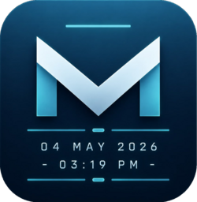
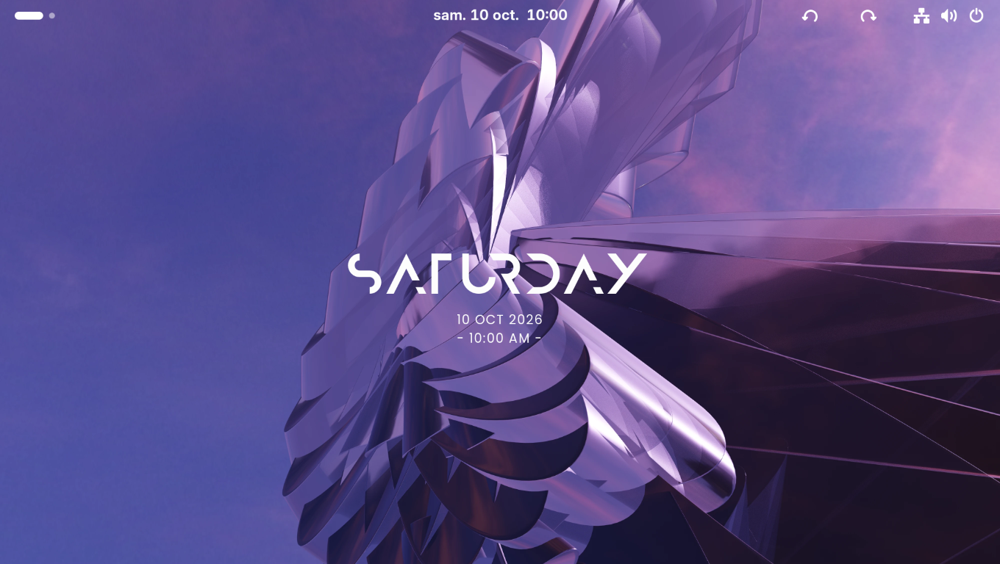
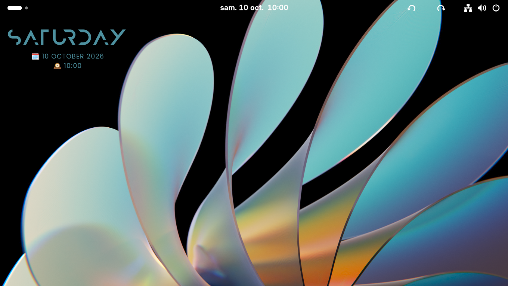
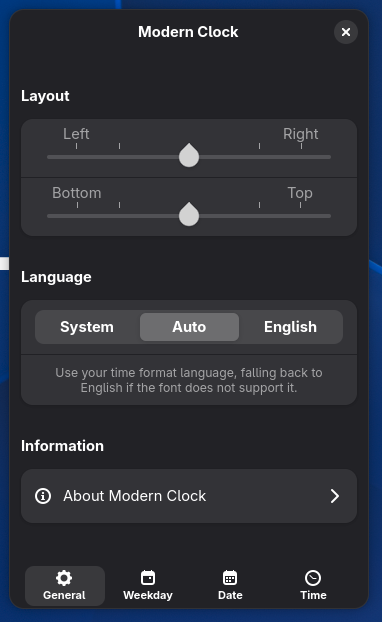
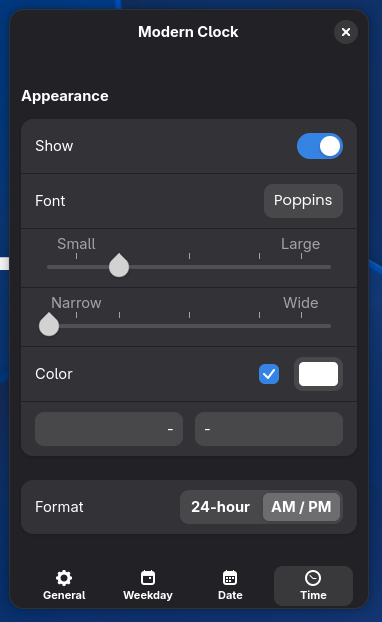

<div align="center">

[![Language: English][badge-readme-en]][readme-en]
[![Язык: Русский][badge-readme-ru]][readme-ru]
[![Langue : Français][badge-readme-fr]][readme-fr]
[![Sprache: Deutsch][badge-readme-de]][readme-de]
[![Idioma: Português do Brasil][badge-readme-pt-br]][readme-pt-br]

# Modern Clock para GNOME



**Um relógio de visual moderno para a área de trabalho do GNOME!**

[![Versões compatíveis do GNOME: 46 a 51][badge-shell]][ego-page]
[![Downloads no site GNOME Extensions][badge-downloads]][ego-page]
[![Licença][badge-license]][license]
</div>

## Recursos

O relógio foi inspirado no [Modern Clock para KDE][modern-clock-kde] e usa as mesmas fontes e o mesmo visual padrão.

- **Posição** — coloque o relógio em qualquer lugar da área de trabalho
- **Ajuste automático do tamanho** — o texto se ajusta ao tamanho de cada monitor, com suporte a HiDPI
- **Suporte a vários monitores** — o relógio aparece em todas as telas e é redimensionado em cada uma separadamente
- **Idioma** — segue as configurações regionais do sistema e usa o inglês se a fonte não tiver os caracteres necessários. Também é possível escolher sempre o inglês
- **Exibição independente** — mostre ou oculte o dia da semana, a data e a hora separadamente
- **Formatos flexíveis** — dia da semana completo ou abreviado, quatro formatos de data e horário de 24 horas ou AM/PM
- **Personalização** — escolha a fonte, o tamanho, o espaçamento entre letras, a cor e os prefixos e sufixos de cada linha
- **Integração opcional com o tema** — use a cor de destaque do sistema ou escolha uma cor personalizada

> [!NOTE]
> A partir do GNOME 48, a extensão carrega as fontes incluídas diretamente e elas ficam disponíveis na hora. No GNOME 46 e 47, as fontes são copiadas para `~/.local/share/fonts/modernclock` no primeiro uso. Encerre a sessão e entre novamente para ativá-las.

## Capturas de tela

<div align="center">




</div>

## Instalação

### Pelo site GNOME Extensions (recomendado)

<a href="https://extensions.gnome.org/extension/9882/modern-clock/"></a>

### Pelo repositório

> [!NOTE]
> Ao instalar pelo repositório, você deixa de receber atualizações automáticas pelo site GNOME Extensions.

#### Opção 1 — pacote ZIP da versão publicada

Baixe `modernclock@gnome.shell-extension.zip` na [página de versões][releases] e execute o comando abaixo.

```bash
gnome-extensions install -f modernclock@gnome.shell-extension.zip
```

#### Opção 2 — instalação a partir do código-fonte

```bash
git clone https://github.com/Tony-Rain/modern-clock-gnome.git
cd modern-clock-gnome
make install
```

#### Ativar a extensão

Após instalar o pacote, encerre a sessão e entre novamente. No X11, você pode reiniciar apenas o GNOME Shell pressionando `Alt+F2` e digitando `r`. Em seguida, ative a extensão pelo aplicativo **Extensões** ou execute o comando abaixo.

```bash
gnome-extensions enable modernclock@gnome-port
```

## Configuração

Abra a janela de preferências pelo aplicativo **Extensões** ou execute o comando abaixo.

```bash
gnome-extensions prefs modernclock@gnome-port
```

<div align="center">




</div>

## Desinstalação

Desinstale a extensão pelo aplicativo **Extensões** ou execute o comando abaixo.

```bash
gnome-extensions uninstall modernclock@gnome-port
```

No GNOME 46 e 47, as fontes copiadas permanecem no sistema. Para removê-las, execute o comando abaixo.

```bash
rm -rf ~/.local/share/fonts/modernclock
```

## Limitações conhecidas

O relógio faz parte da camada de fundo do GNOME Shell. Por isso, fica oculto na tela de bloqueio, na visão geral de Atividades e durante a animação de troca de área de trabalho no Wayland.

## Traduções

Traduções são bem-vindas! A extensão usa `gettext`, então basta um arquivo `.po` para adicionar um idioma. Para traduzir também este README, copie `README.md` para `README.<idioma>.md` (por exemplo, `README.es.md`), traduza o conteúdo e adicione o link à lista de idiomas no início de cada README.

## Licença

Licença Pública Geral GNU, versão 3 ou posterior. Consulte o arquivo [LICENSE][license].

As fontes incluídas seguem suas próprias licenças e ficam fora do código licenciado sob a GPL.

## Agradecimentos

- Projeto original — [Modern Clock para KDE][modern-clock-kde], de Prayag2
- Fontes — [Anurati][anurati] e [Poppins][poppins]
- Traduções — francês por [djinnalexio][djinnalexio], alemão por [FasteryXD][fasteryxd] e português do Brasil por [Fábio Wesen][fwesen]

[badge-readme-en]: https://img.shields.io/badge/Language-English-3584e4
[badge-readme-fr]: https://img.shields.io/badge/Langue-Fran%C3%A7ais-9141ac
[badge-readme-ru]: https://img.shields.io/badge/%D0%AF%D0%B7%D1%8B%D0%BA-%D0%A0%D1%83%D1%81%D1%81%D0%BA%D0%B8%D0%B9-e01b24
[badge-readme-de]: https://img.shields.io/badge/Sprache-Deutsch-26a269
[badge-readme-pt-br]: https://img.shields.io/badge/Idioma-Portugu%C3%AAs_do_Brasil-2ec27e
[readme-en]: ./README.md
[readme-fr]: ./README.fr.md
[readme-ru]: ./README.ru.md
[readme-de]: ./README.de.md
[readme-pt-br]: ./README.pt-BR.md
[ego-page]: https://extensions.gnome.org/extension/9882/modern-clock/
[license]: ./LICENSE
[badge-shell]: https://img.shields.io/badge/GNOME_versions-46_--_51-3584e4?logo=gnome
[badge-downloads]: https://img.shields.io/gnome-extensions/dt/modernclock%40gnome-port?logo=gnome&color=3584e4
[badge-license]: https://img.shields.io/github/license/Tony-Rain/modern-clock-gnome
[modern-clock-kde]: https://github.com/Prayag2/kde_modernclock
[releases]: https://github.com/Tony-Rain/modern-clock-gnome/releases
[anurati]: https://www.behance.net/gallery/33704618/ANURATI-Free-font
[poppins]: https://github.com/itfoundry/poppins
[djinnalexio]: https://github.com/djinnalexio
[fasteryxd]: https://github.com/FasteryXD
[fwesen]: https://github.com/Fwesen
