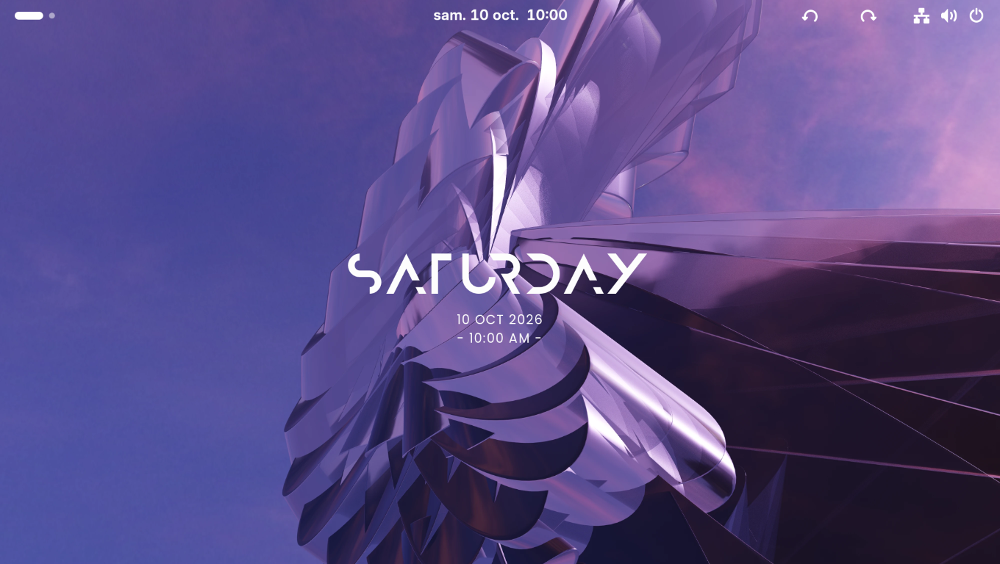
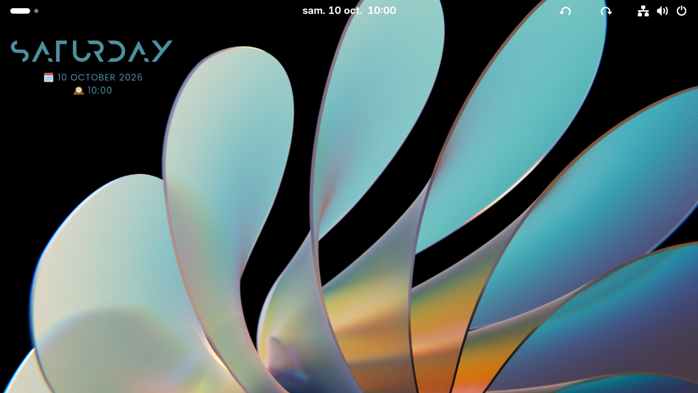
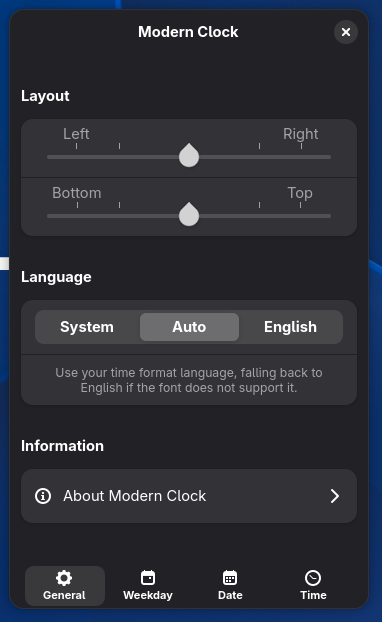
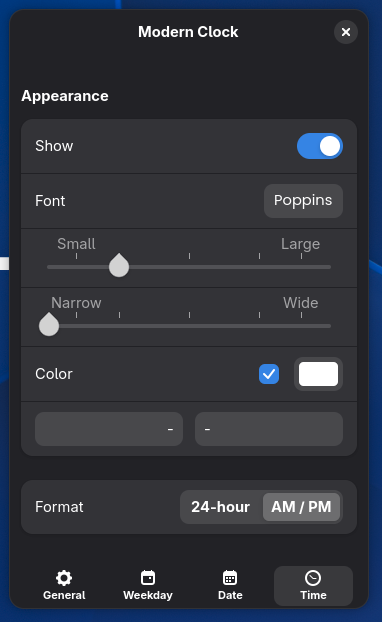

<div align="center">

[![Language: English][badge-readme-en]][readme-en]
[![Язык: Русский][badge-readme-ru]][readme-ru]
[![Langue : Français][badge-readme-fr]][readme-fr]

# Modern Clock for GNOME


**Часы-виджет в современном стиле для GNOME!**

[![Поддерживаемые версии GNOME: с 46 по 51][badge-shell]][ego-page]
[![Загрузки на GNOME Extensions][badge-downloads]][ego-page]
[![Лицензия][badge-license]][license]
</div>

## Возможности

Виджет часов для рабочего стола GNOME, вдохновлённый [Modern Clock for KDE][modern-clock-kde]: те же шрифты и тот же внешний вид по умолчанию.

- **Расположение** — можно разместить в любом месте рабочего стола
- **Автомасштабирование** — размер текста подстраивается под размер каждого монитора (с учётом HiDPI)
- **Несколько мониторов** — часы показываются на каждом мониторе и масштабируются независимо
- **Язык** — следует языку системы, переключается на английский, если шрифт не может его отобразить, или может принудительно использовать английский
- **Показ и скрытие** дня недели, даты и времени по отдельности
- **Гибкие форматы** — полное или сокращённое название дня недели, три вида даты, 24-часовой формат или AM/PM
- **Настраиваемость** — шрифт, размер, межбуквенный интервал, цвет, а также свои префиксы и суффиксы для каждой строки
- **Цвет темы (по желанию)** — можно использовать акцентный цвет системы вместо своего

> [!NOTE]
> При первом запуске встроенные шрифты копируются в `~/.local/share/fonts/modernclock`, и чтобы они применились, нужно выйти из системы и войти снова. После удаления расширения эту папку можно удалить.

## Скриншоты

<div align="center">




</div>

## Установка

### С сайта GNOME Extensions (рекомендуется)

<a href="https://extensions.gnome.org/extension/9882/modern-clock/"></a>

### Из репозитория

> [!NOTE]
> При установке из репозитория расширение не будет получать автоматические обновления с сайта GNOME Extensions.

#### Вариант 1: архив из релиза

Скачайте `modernclock@gnome.shell-extension.zip` со страницы [релизов][releases] и установите командой:

```bash
gnome-extensions install -f modernclock@gnome.shell-extension.zip
```

#### Вариант 2: сборка из исходников

```bash
git clone https://github.com/Tony-Rain/modern-clock-gnome.git
cd modern-clock-gnome
make install
```

#### Включение

После установки выйдите из системы и войдите снова (или на X11 просто перезапустите оболочку через `Alt+F2` > `r`), затем включите расширение в приложении **Расширения** или командой:

```bash
gnome-extensions enable modernclock@gnome-port
```

## Настройка

Откройте окно настроек в приложении **Расширения** или командой:

```bash
gnome-extensions prefs modernclock@gnome-port
```

<div align="center">




</div>

## Удаление

Удалите расширение в приложении **Расширения** или командой:

```bash
gnome-extensions uninstall modernclock@gnome-port
```

Встроенные шрифты после этого остаются в системе. Чтобы удалить и их:

```bash
rm -rf ~/.local/share/fonts/modernclock
```

## Известные ограничения

Часы не видны во время анимации переключения рабочих столов (только на Wayland), на экране блокировки и в «Обзоре». Это связано с тем, что виджет находится в фоновом слое оболочки.

## Переводы

Переводы приветствуются! Расширение использует `gettext`, поэтому для нового языка нужен только файл `.po`. Переводы этого README тоже приветствуются: скопируйте `README.md` в `README.<язык>.md` (например, `README.es.md`), переведите и добавьте в переключатель языков вверху каждого README.

## Лицензия

GNU General Public License версии 3 или более поздней. См. [LICENSE][license].

Встроенные шрифты распространяются по своим собственным лицензиям и не являются частью кода под лицензией GPL.

## Благодарности

- Оригинал: [Modern Clock for KDE][modern-clock-kde] от Prayag2
- Шрифты: [Anurati][anurati], [Poppins][poppins]

[badge-readme-en]: https://img.shields.io/badge/Language-English-3584e4
[badge-readme-fr]: https://img.shields.io/badge/Langue-Fran%C3%A7ais-9141ac
[badge-readme-ru]: https://img.shields.io/badge/%D0%AF%D0%B7%D1%8B%D0%BA-%D0%A0%D1%83%D1%81%D1%81%D0%BA%D0%B8%D0%B9-e01b24
[readme-en]: ./README.md
[readme-fr]: ./README.fr.md
[readme-ru]: ./README.ru.md
[ego-page]: https://extensions.gnome.org/extension/9882/modern-clock/
[license]: ./LICENSE
[badge-shell]: https://img.shields.io/badge/GNOME_versions-46_--_51-3584e4?logo=gnome
[badge-downloads]: https://img.shields.io/gnome-extensions/dt/modernclock%40gnome-port?logo=gnome&color=3584e4
[badge-license]: https://img.shields.io/github/license/Tony-Rain/modern-clock-gnome
[modern-clock-kde]: https://github.com/Prayag2/kde_modernclock
[releases]: https://github.com/Tony-Rain/modern-clock-gnome/releases
[anurati]: https://www.behance.net/gallery/33704618/ANURATI-Free-font
[poppins]: https://github.com/itfoundry/poppins
